# PathSnap

PathSnap - Machine Learning Hackathon

PathSnap is the ML Hackathon map-matching project for GPS map matching and route reconstruction on directed road networks.

## Architecture

```mermaid
flowchart LR
    D[Trip data<br/>track, nodes, arcs, route] --> P[Data pipeline<br/>scripts/build_data_pipeline.mjs]
    P --> C[Candidate JSONL<br/>features + train labels]
    C --> T[Classifier training<br/>scripts/train_classifier.py]
    T --> M[Saved classifier<br/>artifacts/classifier/model.joblib]
    C --> A[Candidate scorer<br/>src/classifier/predict.py]
    M --> A
    A --> S[Candidate probabilities]
    S --> H[HMM decoder<br/>src/hmm/network.py + viterbi.py]
    D --> H
    H --> E[Evaluator pipeline<br/>src/evaluator_pipeline.py]
    E --> API[FastAPI<br/>api/main.py]
    API --> UI[Streamlit map<br/>ui/app.py]
    UI --> L[Toggleable map layers<br/>GPS · roads · classifier · HMM]
    D --> X[HMM comparison and map scripts]
    H --> X
    X --> R[Experiment outputs<br/>results/hmm/]
```



The `.route` files are reference routes. Training labels are created by the data
pipeline as weak geometric proxy labels. The evaluator API keeps reference routes
server-side; prediction inputs contain only GPS tracks and road-network files.

## Project file guide

This guide covers the files maintained by the project. Generated files are outputs,
and each trip folder repeats the same input-file format. Python bytecode caches,
`.pytest_cache`, `.git`, `node_modules`, and `venv` are tool or environment contents,
not application source files.

### Root files

- `.gitignore` — tells Git which generated data, model artifacts, caches, and local environment files to leave untracked.
- `README.md` — project overview, setup and run instructions, data contract, results, architecture, and this file guide.
- `requirements.txt` — Python packages needed for modeling, route decoding, maps, API/UI, and tests.
- `package.json` — Node.js package manifest for JavaScript tooling used by the repository.
- `package-lock.json` — locks the exact Node.js dependency versions for repeatable installs.

### Application code

- `api/__init__.py` — marks `api` as a Python package.
- `api/main.py` — FastAPI app: health and trip-list endpoints, map-data endpoint, prediction endpoint, pipeline loading, and filtering of reference-label fields before responses leave the API.
- `ui/app.py` — Streamlit interface: connects to the API, selects trips, requests route reconstruction, and renders the GPS, nearby-road, classifier, and HMM Folium layers.
- `src/__init__.py` — marks `src` as a Python package.
- `src/evaluator_pipeline.py` — integrates saved classifier probabilities with the HMM decoder for one trip; evaluates against a reference route only in the server-side evaluation hook.
- `src/classifier/__init__.py` — exports the classifier scoring interface.
- `src/classifier/predict.py` — loads the trained model and scores candidate rows or observations.
- `src/hmm/__init__.py` — exports the HMM decoder’s public classes and functions.
- `src/hmm/adapters.py` — converts candidate rows, dictionaries, or matrices into aligned candidate arc and probability arrays; also loads candidate JSONL scores for comparisons.
- `src/hmm/dev_candidates.py` — builds development-only candidate arcs and simulated scores when the trained classifier is not being used.
- `src/hmm/evaluate.py` — aligns GPS observations to reference arcs and computes accuracy, continuity, and candidate-miss metrics.
- `src/hmm/loader.py` — reads a trip’s track, nodes, arcs, and optional route file, then projects coordinates for metric calculations.
- `src/hmm/network.py` — represents directed road arcs and provides bounded shortest-path distances used by HMM transitions.
- `src/hmm/viterbi.py` — implements the log-space Viterbi decoder that selects a likely arc sequence from candidate scores and road connectivity.

### Scripts

- `scripts/build_data_pipeline.mjs` — parses trip files, generates nearby road-arc candidates and training proxy labels, and writes JSONL/EDA outputs.
- `scripts/test_data_pipeline.mjs` — checks data-pipeline output behavior and privacy rules, including evaluator partition isolation.
- `scripts/train_classifier.py` — compares five classifier families with trip-grouped cross-validation, optionally tunes Extra Trees, saves the chosen model, and scores student-test candidates without reading their labels.
- `scripts/compare_hmm.py` — tunes HMM parameters on a training-trip subset, evaluates train and student-test trips, and writes metrics and prediction files.
- `scripts/make_folium_map.py` — creates a standalone interactive Folium map for a trip, using real classifier artifacts when supplied or development stand-in candidates otherwise.

### Tests

- `tests/__init__.py` — marks the test directory as a Python package.
- `tests/test_api.py` — checks API routes, input validation, pipeline behavior, and reference-label filtering.
- `tests/test_classifier.py` — checks classifier data handling, training/evaluation behavior, and prediction interfaces.
- `tests/test_evaluator_pipeline.py` — checks classifier-to-HMM integration and evaluator behavior.
- `tests/test_network.py` — checks directed-network distances and path behavior.
- `tests/test_viterbi.py` — checks decoder outputs, transitions, and edge cases.

### Configuration, documentation, and supplied guidance

- `configs/hmm_params.json` — HMM transition/emission parameters used by the decoder.
- `docs/classifier_interface.md` — candidate/classifier data contract and integration details.
- `docs/classifier_validation.md` — classifier validation approach and metric definitions.
- `docs/hmm_decoder.md` — HMM model, route-decoding details, and integration notes.
- `docs/PULL_REQUEST.md` — project pull-request notes and review context.
- `docs/submission_evidence.md` — evidence and provenance notes for the project submission.
- `Data/Documents/Assessment and Plagiarism Policy.docx` and `.pdf` — supplied assessment and plagiarism policy.
- `Data/Documents/Dataset Exploration.docx` and `.pdf` — supplied dataset exploration notes.
- `Data/Documents/Deliverables.docx` and `.pdf` — supplied project deliverables guidance.
- `Data/Documents/Main Guidelines.docx` and `.pdf` — supplied main project guidelines.
- `Data/Documents/Models and Training Guidelines.docx` and `.pdf` — supplied modeling and training guidance.

### Data and generated outputs

- `Data/Data/train/<trip-id>/` — training input trip files. Each trip has `.track` (GPS coordinates/time), `.nodes` (road-node coordinates), `.arcs` (directed node pairs), and `.route` (reference arc sequence).
- `Data/Data/student_test/<trip-id>/` — student-test inputs in the same format. The pipeline does not use their `.route` files to create labels.
- `Data/Data/evaluator_test/<trip-id>/` — held-out evaluator partition; do not use it for training or tuning.
- `artifacts/data-pipeline/candidates.jsonl` — candidate features for train and student-test trips; student-test labels are null.
- `artifacts/data-pipeline/training_candidates.jsonl` — labeled candidate rows for training trips only.
- `artifacts/data-pipeline/data_quality_report.json` — partition, row, timestamp, coordinate, and ID validation summary.
- `artifacts/data-pipeline/trip_summary.csv` — compact per-trip input and candidate statistics.
- `artifacts/data-pipeline/training_trip_<id>_map.svg` — static GPS/reference-route view for a training trip.
- `artifacts/data-pipeline/README.txt` — generated-output field and label-policy notes.
- `artifacts/classifier/model.joblib` — fitted preprocessing and selected classifier pipeline.
- `artifacts/classifier/metadata.json` — saved model identity, schema, seed, validation and provenance metadata.
- `results/classifier/` — classifier run logs, model comparisons, tuning trials, predictions, plots, timing, and selection rationale (files appear after a full training run).
- `results/hmm/best_params.json` — best HMM parameter configuration from the comparison run.
- `results/hmm/per_trip_metrics.csv` and `summary.json` — per-trip and aggregate evaluation metrics.
- `results/hmm/helped_hurt.csv` — trips where HMM did better or worse than classifier top-1, with comparison context.
- `results/hmm/provenance.json` and `standin_summary.json` — records whether HMM results used real classifier scores or development stand-ins.
- `results/hmm/run.log` — HMM tuning/evaluation progress and logs.
- `results/hmm/maps/<trip-id>.html` — standalone interactive maps generated by the map script.
- `results/hmm/predictions/<trip-id>.npz` — saved per-observation top-1, HMM, and (when available) reference arc IDs for analysis/map generation.

## Candidate classifier (Issue #2)

The classifier consumes the Issue #1 `pathsnap.candidates.v1` JSONL contract. It performs 5-fold
trip-grouped cross-validation over the 80 training trips, compares five distinct model families,
optionally runs Optuna Bayesian tuning, and evaluates unlabeled predictions on the 10
student-test trips. It never reads `evaluator_test`, `.route` files, or evaluator labels.

### Install

```powers
python -m pip install -r requirements.txt
```

Generate candidate JSONL with Issue #1, then run:

```powers
python scripts/train_classifier.py `
  --train-jsonl artifacts/data-pipeline/training_candidates.jsonl `
  --student-test-jsonl artifacts/data-pipeline/candidates.jsonl `
  --artifacts-dir artifacts/classifier `
  --results-dir results/classifier `
  --cv-folds 5 `
  --bayesian-trials 30
```

For a dependency-available run without Bayesian tuning:

```powers
python scripts/train_classifier.py `
  --train-jsonl artifacts/data-pipeline/training_candidates.jsonl `
  --student-test-jsonl artifacts/data-pipeline/candidates.jsonl `
  --disable-bayesian
```

### Training models

The comparison logs five attempted configurations:

- Logistic regression
- K-nearest neighbours
- Random forest
- Extra trees
- Histogram gradient boosting

Extra trees is also eligible for optional Optuna Bayesian tuning. The objective is mean
trip-grouped CV Macro F1. Every attempted model and completed trial is recorded.

### Outputs

- `artifacts/classifier/model.joblib`: complete preprocessing plus selected model pipeline
- `artifacts/classifier/metadata.json`: selected model, seed, schema, CV, and hashes
- `results/classifier/model_comparison.{csv,json}`: per-model CV metrics and timings
- `results/classifier/bayesian_trials.{csv,json}`: all completed tuning trials
- `results/classifier/student_test_predictions.jsonl`: top candidate per student-test observation
- `results/classifier/student_test_summary.json`: unlabeled candidate coverage and timing only
- `results/classifier/timing_seed_config.json`: seed, timing, and environment
- `results/classifier/*_comparison.png`: actual comparison plots
- `results/classifier/selection_rationale.json`: selected model and rationale
- `results/classifier/run.log`: complete run log

Student-test route files and labels are deliberately not opened. Therefore `top1_accuracy`,
Macro F1, LogLoss, and route continuity are `null` for student test by design. They are
measured only on training trip data; LogLoss is candidate-row LogLoss and Top-1 is
observation-level.

### Prediction interface

The saved artifact uses `src.classifier.predict.ClassifierScorer`:

```python
from src.classifier.predict import ClassifierScorer

scorer = ClassifierScorer("artifacts/classifier")
probabilities = scorer.predict_jsonl(candidate_rows)
top_rows = scorer.score_by_observation(candidate_dataframe)
```

Candidate JSONL rows and prediction DataFrames use trip-local `candidate_arc_id` and aligned
probability values, making the result directly usable by the HMM decoder and FastAPI service.

### Tests

```powers
pytest -q tests/test_classifier.py
```

## Team & Roles

- **Akash K:** Data ingestion, trajectory preprocessing, and spatial candidate arc generation.
- **Akash S:** Machine learning candidate classification and probability scoring.
- **Anand (Owner of Issue #3):** HMM / Viterbi route reconstruction decoder, network graph modeling, and route continuity optimization.
- **Amar:** FastAPI backend integration and UI dashboard.

## Data Pipeline (Issue #1)

Run the dependency-free Node.js pipeline from the repository root:

```powershell
node scripts/build_data_pipeline.mjs
```

The default input is `Data/Data`, with `train/` and `student_test/` trip folders. Override paths with `--data <directory>` and `--output <directory>`. Use `--expect-train 80 --expect-student-test 10` for a strict run against the supplied 80/10 partition split.

Run the dependency-free privacy and output regression test:

```powershell
node scripts/test_data_pipeline.mjs
```

The pipeline expects one folder per trip, named by trip ID, with files named `<trip-id>.track`, `.nodes`, `.arcs`, and `.route`. It parses whitespace- or comma-separated numeric rows without headers:

- `.track`: longitude, latitude, timestamp
- `.nodes`: longitude, latitude
- `.arcs`: from-node index, to-node index
- `.route`: one local arc index per row

Arc IDs are zero-based line indices in each trip's `.arcs` file. Node IDs in `.arcs` index the trip's `.nodes` rows. GPS-to-arc distances use a local metric projection of longitude/latitude; final candidate distances are in metres. Candidates are the nearest road segments within 3 km, capped at eight per observation.

For training labels, each GPS point is matched independently to its nearest reference-route segment by point-to-segment distance. This does not pair GPS row `i` with route row `i`. The matched route arc is retained among the candidates, and only training rows receive `0`/`1` labels. Student-test `.route` files are never opened; their candidate labels are `null`.

The route match is a weak proxy label: it assigns each observation to the closest reference-route arc geometrically when that arc is within 500 m. More distant observations are left unlabeled. It does not claim temporal alignment or ground-truth GPS-to-arc labels.

Each candidate JSONL row uses schema `pathsnap.candidates.v1`, with trip and observation identifiers, the local `candidate_arc_id`, a `features` object, and the nullable training label. Features include GPS-to-arc distance, heading difference, arc length, progress along the arc, elapsed time, and GPS speed.

### Outputs

By default, generated files go under ignored `artifacts/data-pipeline/`:

- `candidates.jsonl`: model and decoder candidate/features rows
- `training_candidates.jsonl`: labeled candidate rows from training trips only
- `data_quality_report.json`: partition counts, row counts, malformed rows, timestamp gaps, coordinate bounds, and node/arc ID range checks
- `trip_summary.csv`: compact per-trip metrics
- `training_trip_<id>_map.svg`: actual GPS track and reference route from the first training trip
- `README.txt`: output field and label-policy note

Generated data and EDA artifacts are local outputs; keep the original dataset outside Git. The pipeline enumerates only `train/` and `student_test/`; it never enumerates, opens, parses, or emits `evaluator_test/` files or labels.

## HMM Decoder (Issue #3)

The HMM decoder reconstructs the most likely sequence of road arcs traversed by a vehicle from noisy GPS observations and candidate classification probabilities.

### Key Capabilities

- **Directed Road Network Graph (`src/hmm/network.py`):** Models trip-local directed arcs, edge adjacency, metric arc lengths in metres, and bounded Dijkstra shortest paths with LRU caching.
- **Vectorized Log-Space Viterbi (`src/hmm/viterbi.py`):** Pure NumPy implementation scaling to thousands of observations per second.
- **Physical Transition Dynamics:** Balances road network distance against GPS displacement; handles same-arc travel, connected turns, multi-hop routes, and disconnected leaps.
- **Robust Edge Case Handling:** Handles empty candidate sets, temporal gaps over 15 seconds, numerical underflow, loops, and single-observation trips.
- **Full Teammate Adapter (`src/hmm/adapters.py`):** Converts DataFrame, dict, or matrix candidate outputs into the decoder contract.

### Installation

```bash
pip install -r requirements.txt
```

### Running Tests

```bash
pytest -v tests/
```

### Running Comparison & Tuning

To tune hyperparameters via Group-aware Cross-Validation (GroupKFold by trip) on `data/train` and evaluate on `data/student_test`:

```bash
python scripts/compare_hmm.py
```

Outputs are generated in `results/hmm/`, including per-trip metrics, helped/hurt analysis, a summary, best parameters, and a run log.

### Generating Interactive Folium Maps

```bash
python scripts/make_folium_map.py 00000000
python scripts/make_folium_map.py 00000001
```

Interactive maps are saved to `results/hmm/maps/<trip_id>.html`.

### Empirical Results (10 Student Test Trips)

> **Current artifact status:** the checked-in table is a development comparison
> generated by `src/hmm/dev_candidates.py`, not by Akash S's upstream classifier
> artifact. The corresponding stand-in snapshot is
> `results/hmm/standin_summary.json`, and its provenance is recorded in
> `results/hmm/provenance.json`. No real-classifier result is claimed here.
> The comparison script never reads `data/evaluator_test` or evaluator labels.

| Metric | Classifier Top-1 | HMM Viterbi | Improvement |
| :--- | :---: | :---: | :---: |
| **Observation Accuracy** | 58.35% | **86.14%** | **+27.79%** |
| **Route Continuity** | 61.11% | **88.98%** | **+27.87%** |
| **Candidate Miss Rate** | - | 0.06% | - |
| **Mean Runtime per Trip** | 0.005s | 0.931s | Fast (< 1s) |
| **Trips Helped / Hurt** | - | **9 Helped / 1 Hurt** | - |

For detailed API schemas, mathematical equations, and integration guidelines, see [docs/hmm_decoder.md](docs/hmm_decoder.md).

## Map UI

Start the API and Streamlit map UI from the repository root in separate terminals:

```powershell
$env:PATHSNAP_UI_PARTITION = "student_test"
$env:PATHSNAP_PIPELINE_FACTORY = "src.evaluator_pipeline:create_pipeline"
python -m uvicorn api.main:app --reload
```

```powershell
python -m streamlit run ui/app.py
```

The map UI uses the saved classifier at `artifacts/classifier`, candidate rows at
`artifacts/data-pipeline/candidates.jsonl`, and `configs/hmm_params.json`. It displays
GPS observations, a clipped nearby road network, classifier top candidates, and the
HMM decoded route as independently toggleable layers. The API does not send reference
route labels to the browser.
